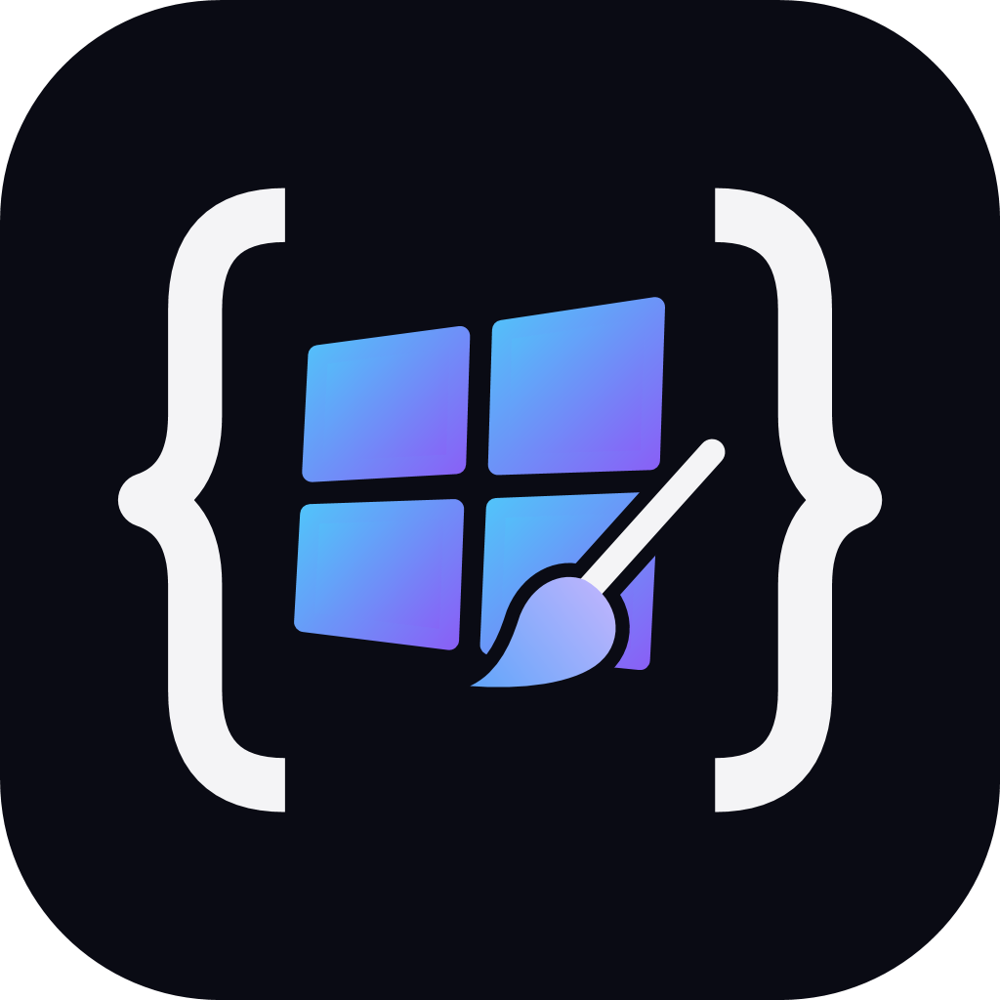
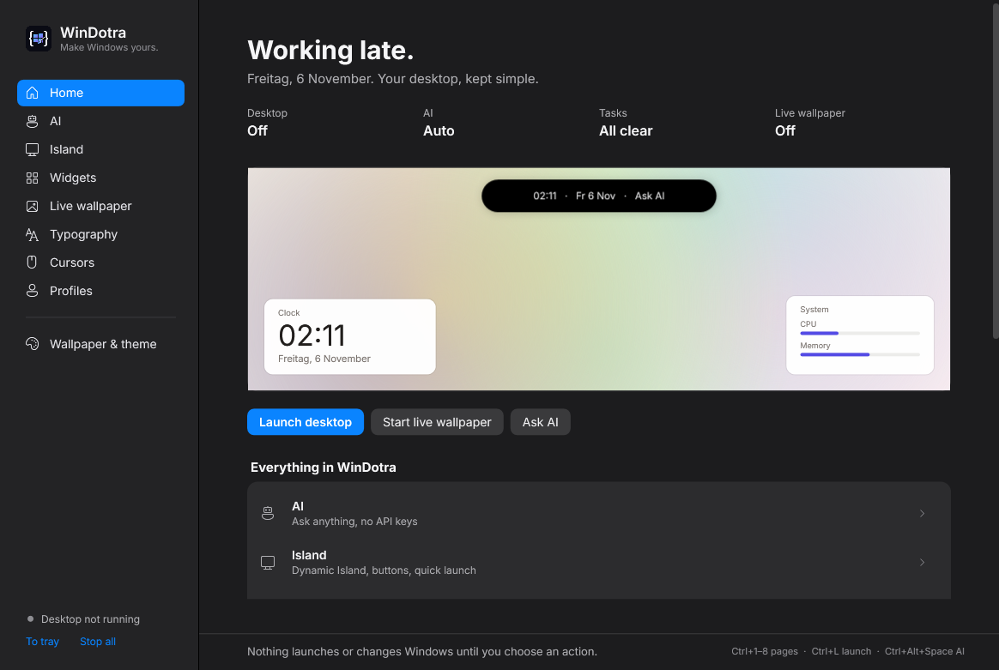
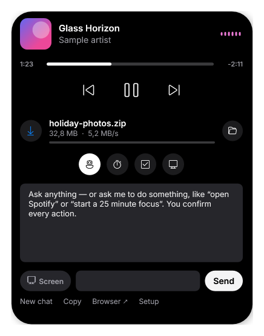

# WinDotra 0.9



**WinDotra — Make Windows yours.**

**Your desktop. Your rules.** An open-source Windows customization toolkit built with C# and WPF. No WinDotra account, no telemetry, no administrator requirement, and no package dependencies.





## New in 0.9: WinDotra

- **New name and logo.** WinCanvas is now WinDotra. Settings stay in `%LOCALAPPDATA%\WinCanvas` so nothing you saved is lost. Put your own artwork at `branding\logo.png` and the build uses it for the app icon, tray, and sidebar.
- **First-run setup.** Pick your AI (WinDotra detects the Claude and ChatGPT apps and the Claude command-line tool), your look, your widgets, and a live wallpaper. Run it again from Home.
- **AI that can look at your screen** when you switch on the screen button for a message (off by default, off again after each message). Works with the Claude command-line tool, Ollama vision models, and the Claude/ChatGPT apps (the screenshot is pasted in for you). The **Claude app** and **ChatGPT app** options open the app and paste your question; you press Enter.
- **Smooth live wallpaper.** Drawn on the GPU with Direct2D on its own thread: 60 fps scenes now take ~7–15 ms per frame instead of 70–180 ms. Seven scenes (Drift, Gradient, Aurora, Lines, Dots, Stars, Clock) with colors, background, speed, density, smoothness (15/30/60 fps), and detail.
- **Island page.** Center the island with one click (or right-click the island), choose its round buttons, and build your own quick-launch row from any app, folder, or website, with real app icons.
- **macOS-style widgets.** Square and wide tiles without title bars (drag anywhere): analog or digital clock, calendar with a big date, CPU/memory/battery rings, a focus timer ring, Notes, and new **Now Playing** and **Reminders** widgets.
- **Fonts.** Searchable list with live previews, install your own .ttf/.otf/.ttc (for your account, no admin), and 18 free fonts from Google Fonts in one click.
- **Cursors.** Live previews of all 14 pointers, seven built-in Windows schemes, and cursor-pack import from a .zip or folder (reads install.inf).

## 0.8: always there

- **Runs in the background.** Closing the window keeps the island, widgets, and live wallpaper running; quit from the tray icon. Optional "Start WinDotra quietly when I sign in" on Home.
- **Live wallpaper works on Windows 11 24H2+.**
- **AI that can do things.** Ask "open Spotify", "turn the volume up", or "start a 25 minute focus". The AI suggests an action card; nothing happens until you click **Run**. Only these actions exist: open an app, website, folder, or settings page; web search; play/pause/next/previous; volume; lock the PC; focus timer; add a task. It cannot run commands or scripts.
- **F R I D A Y** date on the desktop (Rainmeter style) and frosted-glass widgets.

## 0.7: Apple-style island

The island now follows Apple's Dynamic Island: a pure black pill with a tiny album cover and a waveform in the album's color, springing open into art, title, a seek bar with time left, and plain white controls. AI, focus, tasks, and system live in a row of round icons. The rainbow glow is optional (Widgets → Island → aura).

## 0.6: a real Dynamic Island

- **Now playing:** the island is a black pill that shows the song, artist, and album art from whatever is playing (Spotify, browsers, Media Player, and anything else that shows up in Windows' media controls). Open it for a seek bar with times and previous/play/next buttons.
- **Live waveform:** bars that move with the actual loudness of your speakers.
- **Downloads:** browser downloads in progress (bytes received and speed), then "Downloaded" with an Open button.
- **Glow:** an animated rainbow edge while music plays or something downloads. Each part can be turned off under Widgets → Island.

## 0.5: calm, keyless, alive

- **Minimal redesign:** light paper background, ink text, hairline sections, one indigo accent. Widgets adapt their text to light or dark backgrounds.
- **AI without API keys:** Auto uses free local AI (Ollama), then your Claude subscription through the Claude command-line tool, and otherwise opens claude.ai or ChatGPT with your question typed in. One-click Ollama model downloads.
- **Live wallpaper:** four quiet animated scenes (Drift, Lines, Dots, Clock) behind your desktop icons, light or dark, paused while a full-screen app is in front.
- Eight minimal widget themes and a Home page with a live preview.

## 0.4: a full visual overhaul

- A new dark design system across Studio, the appearance editor, and overlays: toggles, sliders, dropdowns, inputs, and scrollbars all match.
- Icon sidebar, a dashboard with live status cards, and clickable module tiles. Ctrl+1–6 switches pages; Ctrl+L launches.
- Live preview while styling widgets, plus eight one-click themes.
- A Calendar widget, load-aware CPU/memory/power meters, a focus progress bar, and more island quick launchers.
- Four more wallpaper moods, a dark title bar, and a proper tray icon.

## 0.3: an AI inside your island

- Claude, OpenAI, OpenAI-compatible chat endpoints, and local Ollama.
- Streaming replies, Stop, New chat, Copy reply, and Plan/Rewrite/Explain prompt starters.
- Ctrl+Alt+Space opens AI chat while WinDotra is running.
- Optional account-encrypted conversation history; separately encrypted provider keys.
- A local task checklist, expanded-width control, hover expansion toggle, and optional focus completion sound.

## Features

- **Five widgets:** clock/date, live CPU/memory/power meters, editable notes, a focus timer with progress, and a month calendar. Drag titles to arrange them. Positions and notes persist locally.
- **Dynamic Island-style overlay:** compact clock/power or focus status, expanding on hover. Click the status line to pin it open. Includes system meters, focus controls, and launchers for Files, Calculator, Notepad, Snip, and Settings.
- **Typography:** installed fonts and 11–28 px sizing for widgets/island; classic Windows caption, menu, status, and dialog fonts at 8–20 pt with separate restore.
- **Cursors:** static `.cur` or animated `.ani` files for 14 roles. Hover a selected filename to preview. Files are validated and copied into managed storage, with separate restore.
- **Styling:** widget/island width, accent/background colors, opacity, widget corner radius, always-on-top, position locking, 12/24-hour clock, and focus duration.
- **Profiles:** save, import, and export widget layouts as JSON. Profiles include note text; review private notes before sharing.
- **Tray controls:** hide Studio while widgets run, return from the tray, or stop all overlays.
- **Appearance:** original wallpaper palettes, custom wallpaper colors, separate app/Windows light-dark modes, transparency, and undo.

This is a standalone toolkit, not a Windhawk-compatible mod host. It does not inject into other processes or load executable mods. Widgets are floating windows, not Explorer desktop children; always-on-top can be disabled. The island supports AI chat, a local checklist, clock/power, statistics, focus, and fixed launchers. It shows now-playing media through Windows media controls, but not Windows notifications (those require a packaged Store app). It does not automatically hide in fullscreen games.

## Run

Windows 10/11 with .NET Framework 4.8. Unzip the portable release and double-click **WinDotra.exe**, keeping `WinDotra.exe.config` beside it. The executable is unsigned; you can review and build the source locally.

1. Open **Widgets & island**, choose modules and styles, and click **Save & launch desktop**.
2. Drag widget titles to position them. Use **Reset positions** if needed; right-click a title to hide that widget until the next launch.
3. Use **Typography** and **Cursors** for those settings. Windows changes happen through their explicit Apply buttons.
4. Choose **Hide to tray** to keep widgets running. Double-click the tray icon to return. Closing Studio quits all overlays. No startup entry is installed.
5. **Wallpaper & theme** opens the original appearance editor. Each Windows module has its own one-step restore.

Focus timers reset when the app quits and are not exported as running sessions. Changing focus duration takes effect when you reset the timer. Notes save once per second after editing and when stopping overlays.

Classic font changes do not replace system font files or force fonts in modern apps, Start, or Settings. Some apps need reopening or sign-out to refresh appearance. Managed-device policies can prevent changes. WinDotra never restarts Explorer or signs you out.

Wallpaper application sets one static image using existing Windows fit settings. Undo restores the previous image path, not slideshow/Spotlight configuration or per-monitor layouts. Leave “Apply this wallpaper” unchecked to preserve those modes. Wallpaper palette colors do not set Windows accent colors.

## AI without API keys

Open **AI** in WinDotra and pick how the island answers. Every choice saves immediately.

- **Auto (recommended):** free local AI if it's installed, then your Claude subscription, otherwise your browser.
- **Free local AI:** install [Ollama](https://ollama.com/download) (free) and open it, then click one of the model buttons (gemma3:1b, llama3.2:3b, or qwen2.5:7b). WinDotra asks your local Ollama to download it and uses it automatically. Everything stays on your PC.
- **Your Claude subscription:** install the Claude command-line tool once (`irm https://claude.ai/install.ps1 | iex` in Windows PowerShell) and run `claude` once to sign in. WinDotra then runs `claude -p` in an empty temporary folder and streams the answer into the island.
- **Browser:** opens claude.ai or chatgpt.com with your question filled in, using the account you're already signed in with. Very long questions are copied to the clipboard instead. The question appears in the page address, so it can end up in your browser history.

Only what you type, the recent chat, and the assistant instructions are sent, and only when you press Send. Nothing reads your screen, clipboard, files, notes, or tasks. Replies are text; the island cannot run commands. **Remember chats** stores history encrypted for your Windows account; **Delete saved chats** removes it. API keys saved by older versions can be deleted from the AI page.

## Live wallpaper

Open **Live wallpaper**, pick a scene, and click **Start**. WinDotra places its own animated window in the layer Windows uses for the desktop background (the `WorkerW` window), behind your icons. It doesn't inject code into Explorer or change your wallpaper setting or files. Stopping it, **Stop all**, or quitting WinDotra repaints your normal wallpaper. It runs at up to 30 frames per second (once a second for Clock) and pauses while a full-screen window is in front. Turn on **Start with the desktop** to run it whenever you launch widgets. `WinDotra.exe --media-check` reports whether a media session, album art, and audio level were found (no titles). `WinDotra.exe --wallpaper-check` attaches a scene for three seconds and writes the result to `wallpaper-check.txt`.

## Build

Open Windows PowerShell in the source folder:

```powershell
powershell -NoProfile -ExecutionPolicy Bypass -File .\build.ps1
```

This process-only option does not change your saved PowerShell policy. The build uses the .NET Framework compiler included with Windows; no NuGet restore or .NET SDK is needed. Output: `dist/WinDotra.exe` and its configuration file.

## Verify

```powershell
$p = Start-Process .\dist\WinDotra.exe -ArgumentList '--self-test' -Wait -PassThru
Get-Content .\dist\test-results.txt
$p.ExitCode
Start-Process .\dist\WinDotra.exe -ArgumentList '--studio-smoke docs/studio-preview.png' -Wait
Start-Process .\dist\WinDotra.exe -ArgumentList '--smoke-test docs/preview.png' -Wait
```

Tests use fake Windows backends to verify appearance recovery, font/cursor rollback, absent values and registry types, restore retries, profile validation/roundtrips, native structure sizes, and timer pause/resume/completion after sleep.

AI tests use simulated HTTP streams to verify all three protocol formats, Unicode, interrupted responses, authentication errors, cancellation, account encryption, provider separation, and bounded history. No real API key or billable request is used.

The Studio smoke test also exercises Send, Stop, New chat, draft preservation, and reply rendering with a simulated provider. It renders every page, opens all five overlays, expands the island, samples system statistics, and reads Windows fonts/cursor settings without writing them. It uses temporary profile storage and closes everything afterward. Exit code 0 means success. Failures write `test-results.txt` or `smoke-error.txt` beside the executable.

Build, automated tests, and Studio smoke test passed on the development machine. Live provider calls have not been tested with real credentials. Actual Windows font, cursor, theme, and wallpaper writes still need validation in a disposable Windows account/VM before broad release. Also test Windows 10/11, mixed-DPI monitors, keyboard navigation, file dialogs, managed-device failures, tray lifecycle, and sign-out refresh.

## Recovery and storage

All state is local to `%LOCALAPPDATA%\WinCanvas`:

- `ai-settings.json`: AI mode, local model, browser site, instructions, and chat preferences.
- `credentials/`: only present if an older version saved API keys; delete them from the AI page.
- `chat-history/`: optional account-encrypted conversations, in hashed `.protected` files.
- `desktop.json`: widget/island profile, positions, notes, checklist. Dragging a widget or editing notes also saves the current profile.
- `fonts-undo.json`: original classic UI fonts, restored through `SPI_SETNONCLIENTMETRICS` while preserving current non-font metrics.
- `cursors-undo.json`: original values, types, and existence of 14 roles under `HKCU\Control Panel\Cursors`. The scheme reloads through `SPI_SETCURSORS`.
- `cursors/`: copied cursor files. Original files referenced by an undo backup must remain available for restore.
- `undo.json`: previous existence and DWORD values of `AppsUseLightTheme`, `SystemUsesLightTheme`, and `EnableTransparency` under `HKCU\Software\Microsoft\Windows\CurrentVersion\Themes\Personalize`, plus the prior wallpaper path.
- `wallpaper-*.bmp`: generated 4K images, about 32 MB each. Unique filenames preserve earlier images for recovery.

Font, cursor, and appearance undo points are independent. Applying again in a module replaces only that module's previous undo point. Recovery is saved before changes; failed applies attempt rollback. Failed restores retain their backup for retry. Undo restores managed preferences, not a complete Windows theme or cursor-scheme definition.

Profiles exclude AI settings, keys, conversations, Windows font/cursor backups, cursor assets, running timers, and wallpaper settings. They do include notes and checklist text. Fonts must be installed on the destination PC or Windows substitutes a fallback. Imports create a draft; they do not execute commands or change Windows settings. Share only fonts and cursors you have permission to redistribute.

Generated images and copied cursors are not automatically deleted. Do not delete files currently used by Windows or referenced by a backup. To uninstall, restore fonts, cursors, and appearance separately, close Studio including its tray icon, and remove the program folder. Once no managed image/cursor is in use, you can remove `%LOCALAPPDATA%\WinCanvas`. No services or scheduled tasks are installed.

References: [Windows appearance settings](https://learn.microsoft.com/en-us/windows/apps/develop/settings/settings-common), [SystemParametersInfo](https://learn.microsoft.com/en-us/windows/win32/api/winuser/nf-winuser-systemparametersinfow), [NONCLIENTMETRICS](https://learn.microsoft.com/en-us/windows/win32/api/winuser/ns-winuser-nonclientmetricsw).

## Publish on GitHub

1. Extract the source archive and create an empty repository named `WinDotra`.
2. Upload the source folder contents, including `src`, `docs`, `.github`, `build.ps1`, and `LICENSE`, not just the ZIP. Git ignores local builds through `.gitignore`.
3. Suggested description: “An open-source Windows customization studio with widgets, an island overlay, fonts, cursors, and reversible appearance controls.”
4. GitHub Actions builds and tests on every push. Attach the portable ZIP to a GitHub Release for users who want the app.

## License

[MIT](LICENSE). See [CONTRIBUTING.md](CONTRIBUTING.md).


## Store and website

The project website lives in `docs/` (publish it with GitHub Pages from the `docs` folder). Its `docs/store` folder is the community store: styles (`.windotra-style`) and widgets (`.windotra-widget`) plus `index.json`. WinDotra ships a copy for offline use and reads the online catalog from the website. To share something, add your file and an `index.json` entry in a pull request.
